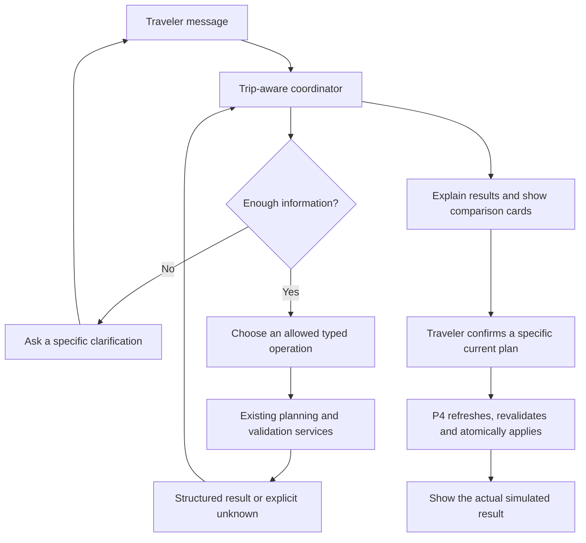

# Conversational agent assessment for Roam

Assessment date: **2026-11-01**. This is a design proposal based on the local P3
connection-validation follow-up. The implemented change is the P3 validation fix;
the conversational coordinator and chat panel are proposed work.

## Recommendation

Add a trip-aware assistant opened from the bottom-right corner. Start with risk
explanation, traveler-reported changes, finding alternatives and comparing the
returned plans. The assistant should operate the existing planning services and
show their results as actionable cards. Keep the itinerary, forms and comparison
views available alongside the conversation.

The agentic behavior comes from a model choosing allowed operations, reading the
results, asking for missing information and deciding the next step. A chat panel
provides the interface for that behavior. Anthropic's architectural distinction
between predefined workflows and model-directed agents is useful here; it also
recommends starting with the simplest approach that satisfies the task.
[Source: Building effective agents](https://www.anthropic.com/research/building-effective-agents).

## What the repository already implements

| Component | Current behavior | Agentic capability still to add |
| --- | --- | --- |
| [BackupAgent](../travel-planner/planning/agent.jac) | Optional typed model selection from complete, already validated candidate IDs; invalid choices fall back to deterministic results. | Interpret an open-ended request, choose tools, clarify missing facts and react to tool results. |
| [ReplanAgent](../travel-planner/replan/agent.jac) | Optional typed selection from supplied legacy combinations. | Coordinate the connected planning flow through its shared service boundary. |
| [PolicyAgent](../travel-planner/policy/agent.jac) | Optional extraction with source checks and rule fallback. | Resolve the outstanding P2 negation/fee defects before exposing confident refund advice. |
| [Server services](../travel-planner/server/main.jac) | Saved trips, facts, alternatives, version checks, proposal review and simulated application. | A conversational session, typed actions, tool dispatch, bounded execution and action receipts. |
| [Planning panel](../travel-planner/planning/frontend.jac) | Forms, risk selection, deterministic comparisons and explicit accept/keep controls. | A conversation launcher, clarification UI and cards connected to the same reviewed proposals. |

The current product is an LLM-assisted planning workflow with working tools and
strong deterministic boundaries. It does not yet contain a general conversational
agent. `by llm` is used for bounded tasks; the model does not currently decide
which service to call next.

## Proposed execution model

Use one conversational coordinator with tools supplied by P1–P5. The existing
modules retain their responsibilities; five independent conversational models
are not required for the MVP. Let deterministic generation run with
`use_llm=False` when the coordinator will already explain or select its outputs,
so the first prototype avoids redundant nested model calls.

Reuse the typed `by llm` boundary already tested in this checkout. A small server
loop can request a typed `AssistantAction`, validate it, execute an allowed tool
and feed the structured observation into the next step. The current Jac reference
also documents native tool calling. Verify its exact interface against pinned
Jac **0.37.23** before implementing that variant; current online documentation can
describe newer runtime features.
[Source: Jac byLLM tool calling](https://docs.jaseci.org/reference/plugins/byllm/#tool-calling-react).

## A useful first conversation

Traveler: “It is raining. Find three alternatives for the outdoor activity.”

1. Read the selected trip, current requirements and existing risks.
2. Resolve which activity the traveler means. Ask if more than one fits.
3. If needed, record the explicit traveler report with its provenance through a
   narrow version-checked wrapper around the existing planning-context service.
4. Call `generate_backup_plans` for the current trip/version and relevant risks.
5. Show the returned plans, computed price/time changes and unresolved facts.
6. Let the traveler select and confirm a specific plan. Call
   `review_backup_plan` with its stored proposal ID; show the actual result.

“Find other plans” uses the existing stable candidate exclusions. “Compare the
second and third plans” reads the calculated metrics. “Use the second one” resolves
against the current displayed result set and opens its confirmation card. A stale
or ambiguous reference triggers clarification or fresh generation.

## Tool and UI scope

| Capability | First version |
| --- | --- |
| Explain the selected trip and detected risks | Read current structured facts; expose uncertainty. |
| Report rain or an arrival delay | Preserve the traveler as the source; request missing item/time/timezone details. |
| Find and compare alternatives | Reuse P3 generation and deterministic validation/comparison; the model cannot invent candidate IDs or metrics. |
| Accept a plan | Use a separate confirmation card and the existing version-safe P4 boundary. A proposed tool call does not confirm itself. |
| General trip/item edits | Add staged diffs, version checks and idempotent execution first. Existing `save_item` has no client-supplied expected-version guard; exposing it directly to a stale agent session would allow overwrites. |
| Generate a new itinerary from destination/dates/budget | Depends on the missing initial planner in #5. A conversation can collect inputs, but the chat UI does not implement that generator. |
| Give refund or cash-due-now assurances | Depends on P2 negation/fee fixes (#10) and P5 payment-timing inputs (#13). Keep these assurances out of the first assistant. |
| Make external bookings or cancellations | Later scope. Current acceptance changes a simulated itinerary only. |

On desktop, use a compact launcher opening a side panel with the selected trip
name, suggested requests, a transcript and embedded comparison cards. On narrow
screens, use a full-height sheet. Keep readable itinerary context visible when
space allows. Changing trips clears or switches the conversation context.

Show short progress states such as “Checking your trip” and “Comparing options,”
plus a stop control. Raw tool payloads, IDs and execution traces belong in explicit
diagnostics. Preserve the existing default presentation rules.

## Execution boundaries

- Bind every action to a server-owned trip/session and authoritative version.
  Treat displayed ordinal references as pointers to stored proposals, not IDs
  that the model may fabricate.
- Keep active-itinerary writes behind a reviewed action or explicit plan
  confirmation. Reuse transactional revalidation; a read-then-write wrapper is
  insufficient for general CRUD concurrency.
- Use a bounded loop, total deadline and cancellation. An initial limit of three
  tool steps before explaining or asking a question is a reasonable prototype
  setting to evaluate. Tool failures and missing evidence stay explicit.
- Supply relevant trip facts, constraints, computed summaries and recent
  observations. Keep unrelated trips and credentials out of the model context.
  Cross-trip memory remains later scope.
- Treat policy/provider text as data. Validate tool names, arguments and result
  IDs on the server; totals, feasibility, deadlines and evidence come from code.
- Keep model errors recoverable through the existing forms and planning views.
  Label scripted/offline intent handling if used for a demo.

## Acceptance criteria for a conversational prototype

The prototype should demonstrate a Chinese and an English request, an ambiguous
time or item that requires clarification, and a tool failure that preserves the
trip. It should also show an unknown-evidence result that cannot be accepted,
distinct follow-up alternatives, a stale-plan rejection and an exact successful
simulated application after confirmation.

Test hallucinated IDs, cross-trip references, repeated requests and concurrent
edits at the service boundary. Keep a small set of manually labeled intents and
compare tool/argument choices with a typed model stub before a live-model smoke
test. Do not equate fluent replies with successful execution.

## Delivery order

1. Finish and verify the P3 connection constraint path.
2. Implement the bounded coordinator, trip/session state and a few read/proposal
   tools with typed stubbed model outputs.
3. Add the bottom-right launcher, transcript, clarification and comparison cards.
4. Add explicit confirmation and action receipts, then verify a live model.
5. Expand general edits and financial explanations as their owning modules and
   concurrency/financial contracts become ready.

The first user-visible goal is a complete “report a change → inspect feasible
alternatives → compare → confirm a simulated update” conversation. This gives
the project a useful agentic interaction while retaining the tested planning
services as the authority for the result.
